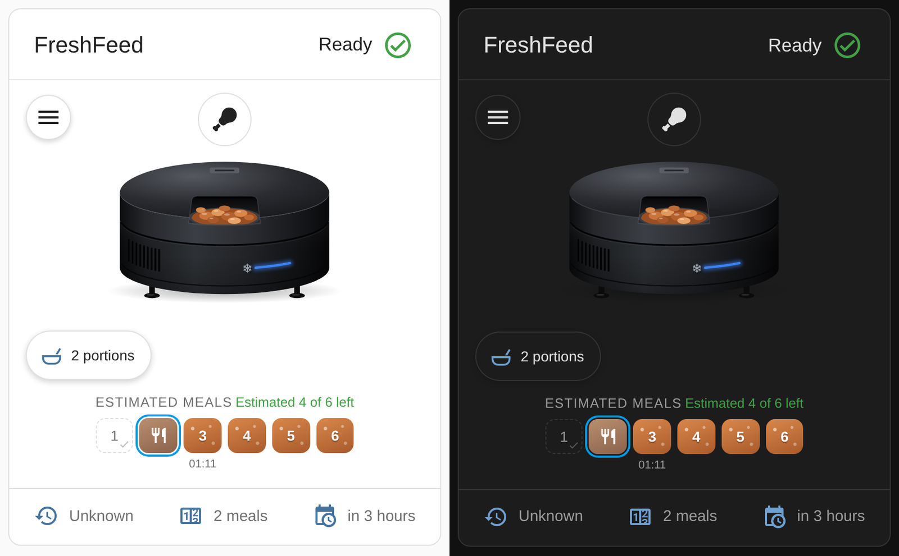
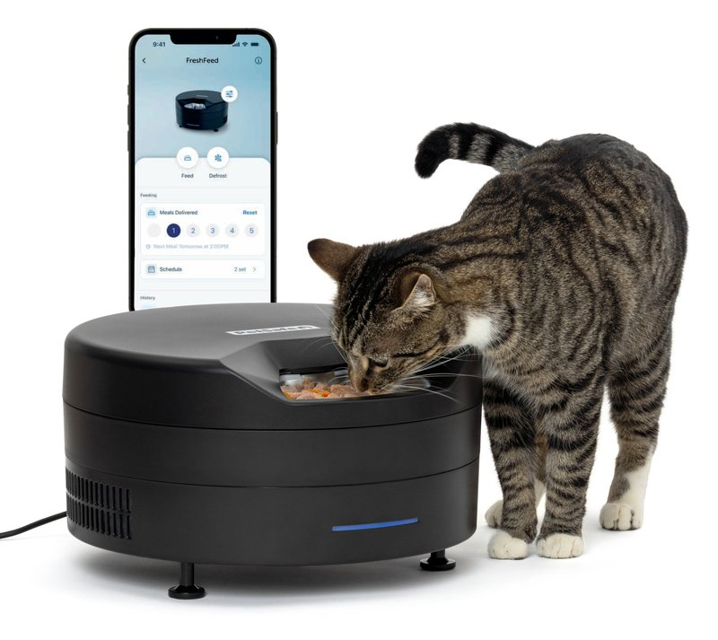

# Pet Feeder Card

[](https://hacs.xyz/docs/faq/custom_repositories/)
[](https://github.com/sudolulo/pet-feeder-card/releases)
[](LICENSE)



A Home Assistant dashboard card for PetSafe FreshFeed and Aqara C1. Card version **0.4.1** is independent of the integration version. The FreshFeed integration requires Home Assistant 2026.10.0 or newer; the card's Aqara and raw modes are independent. This community project is not affiliated with PetSafe, FreshFeed or Aqara.



## Install

Add `https://github.com/sudolulo/pet-feeder-card` to HACS custom repositories as **Dashboard**, then download. If HACS registered the resource, do not add it twice; otherwise add `/hacsfiles/pet-feeder-card/pet-feeder-card.js` as a JavaScript module resource. Refresh the browser. For manual installation, copy all four distribution modules (`pet-feeder-card.js`, `freshfeed-model.js`, `pet-feeder-card-editor.js`, `freshfeed-editor-model.js`) into `/config/www/pet-feeder-card/`, and register `/local/pet-feeder-card/pet-feeder-card.js` as a module resource. Do not use a single-file release asset.

To install a release other than the latest, download the latest release first, then choose the other version from the installed repository in HACS. On a repository that has never been downloaded, HACS otherwise installs the latest release's files whichever version you select.

The visual editor discovers FreshFeed devices and entities using the Home Assistant registry when available. If discovery is denied, missing or ambiguous, use its manual fields or YAML and supply the correct bindings yourself.

## FreshFeed raw example

Replace example IDs with your own. Raw mode displays selected literal states without inferred health or controls.

```yaml
type: custom:pet-feeder-card
model: freshfeed
mode: raw
raw_entities:
  - sensor.example_state
  - binary_sensor.example_fault
```

## Aqara example

Use entities supplied by an existing integration, such as Zigbee2MQTT.

```yaml
type: custom:pet-feeder-card
model: aqara_c1
entities:
  food_level: sensor.example_food_level
  portions_today: sensor.example_portions_today
```

These raw and Aqara examples configure no actions and send no device commands. Missing or unavailable entities do not prove a fault.

## FreshFeed semantic example

Install the [FreshFeed integration](https://github.com/sudolulo/petsafe-freshfeed) separately and replace all example bindings with your actual integration entry and entities. This example configures no action buttons, but is **not inherently read-only**: the FreshFeed dialog can save schedules and expose guarded commands and recovery when integration controls are enabled and administrator and state checks permit them.

```yaml
type: custom:pet-feeder-card
model: freshfeed
freshfeed:
  entry_id: example_entry_123
  schedule_entity: sensor.example_schedule
  write_status_entity: sensor.example_write_status
  quick_feed_entity: sensor.example_quick_feed
  history_entity: sensor.example_history
entities:
  status: sensor.example_status
  food_level: sensor.example_food_level
  meals_left: sensor.example_meals_left
  last_fed: sensor.example_last_fed
  next_meal: sensor.example_next_meal
  error: binary_sensor.example_fault
```

## Confirmed Feed fragment

Add this actions-only fragment to the semantic example if you want a Feed button. The existing `freshfeed.entry_id` supplies the entry ID; the card supplies `confirmed: true` only after its confirmation gesture.

```yaml
actions:
  - name: Feed
    icon: mdi:food-drumstick
    action: petsafe_freshfeed.command
    data:
      operation: feed
    confirm: true
```

## Configuration reference

- `type`: `custom:pet-feeder-card`. Required `model`: `freshfeed` or `aqara_c1`.
- `mode`: `standard` by default; `raw` is FreshFeed only. Raw requires `raw_entities`: 1 to 32 unique `sensor` or `binary_sensor` entity IDs with lowercase letters, digits or underscores in the object ID, and disallows nonempty `entities`, `actions` and `controls` and the `freshfeed` mapping. It forces chip off, empty footer and no meal tray. `raw_entities` is prohibited in standard mode.
- `name` defaults to FreshFeed or Aqara C1; `color` is `black` or `white` (defaults black for FreshFeed, white for Aqara); `food_label` defaults to Food; `art_level` is `hopper` (default) or `bowl`.
- `meal_slots` is an integer from 1 to 12 or null (no tray); defaults to 6 for FreshFeed and null for Aqara.
- `entities` maps any of `status`, `food_level`, `error`, `last_feed`, `last_fed`, `portions_today`, `weight_today`, `counter`, `meals_left`, `schedule`, `next_meal`, `temperature`, `camera` to entity IDs.
- Optional `freshfeed` enables semantic integration features only in FreshFeed standard mode. Supply all five nonempty fields and no others: `entry_id`, `schedule_entity`, `write_status_entity`, `quick_feed_entity`, `history_entity`. Use the real entry ID, not a placeholder.
- `chip` defaults to `last_feed`; set false or null to hide it. `footer` defaults to [`last_fed`, `portions_today`, `next_meal`] and accepts at most 3 items. Both accept display keys `last_feed`, `last_fed`, `portions_today`, `weight_today`, `counter`, `next_meal`, `temperature`, `food_level`.
- `actions` defaults to an empty list and accepts at most 3 buttons. Each requires `action: domain.service` and may specify `name`, `icon`, `target`, `data` and `confirm`. Name defaults to the action, icon to `mdi:gesture-tap-button`, and confirmation defaults true. With `freshfeed` bound, only `petsafe_freshfeed.command` with data containing exactly `operation: feed`, `defrost`, or `refilled` is allowed; no target, extra data fields or `confirm: false`. Cancel and recovery belong to the dialog.
- `controls` defaults to an empty list of entity IDs. With `freshfeed` bound, `text` and `button` entity controls are prohibited.

## Safety and limitations

Controls are opt-in in integration options and require an administrator context; automations are not automatically authorized. Cancel is not an emergency stop. Inspect the feeder before recovery. Recovery uses local read-only observations and sends no command. Strict observed-safe recovery clears local uncertainty when the required evidence is present, but does not prove physical success. Local abandonment can release an uncertain operation but its execution remains unknown. With a 0.5.0 backend, the card uses the strict resolved and reported-idle fallback rather than inferring abandonment. It does not prove the feeder is idle or that the previous operation completed. New commands are separately checked: an empty tray still denies feeding. If the feeder has not reported its quick-feed state, a narrow fresh-local observation exception can permit a new command; a pending unreported feed could cause an extra meal. Check the feeder before acting. Do not retry a possibly sent command or delete/reset storage as a workaround.

A last-known schedule remains visible and editable; unknown is not an empty plan. In Fully local mode a never-observed schedule cannot be replaced until observed. A cloud-read plan is labelled as such and cannot acknowledge a command. The five-minute near-meal warning is advisory and does not block saving. Food and meals remaining are estimates based on compartments and an assumed refill, not measurements of food or consumption. History and statistics reflect locally observed reports, exclude offline gaps and cloud history, have no backfill, and recent unsaved increments can be lost. A displayed next meal is a projection, not a promise.

Check Home Assistant **Settings > System > Repairs**, download redacted integration diagnostics, and check feeder power, LAN and address if unavailable. Reconfigure the address rather than resetting. See the [integration README](https://github.com/sudolulo/petsafe-freshfeed) for setup, privacy, safety and optional blueprints; HACS does not automatically install root blueprints, which notify or update helpers rather than command the feeder. The official app is needed only for first Wi-Fi pairing and firmware updates, not routine recovery.

Issues: https://github.com/sudolulo/pet-feeder-card/issues. Original artwork and code are MIT licensed; see [LICENSE](LICENSE) and [NOTICE](NOTICE).
